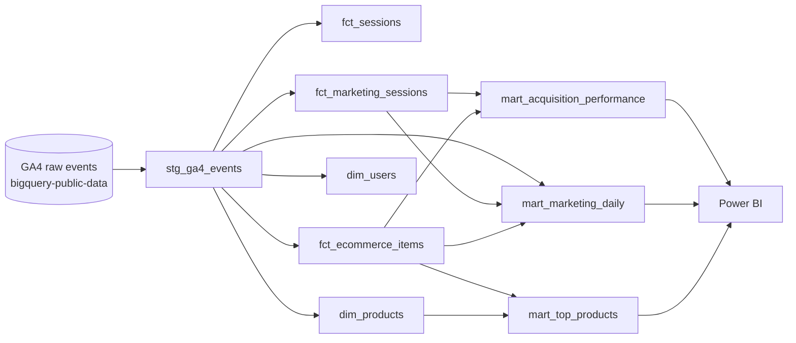

# GA4 Marketing Data Warehouse

An end-to-end analytics project that turns raw Google Analytics 4 (GA4) e-commerce events into a tested, analysis-ready data warehouse with **BigQuery** and **dbt**, and a **Power BI** dashboard on top.

**Business questions answered**
- Which marketing channels bring the most users, sessions and revenue?
- How do sessions move through the shopping funnel (view item → add to cart → checkout → purchase)?
- How do traffic, revenue and conversion rate change over time?
- Which products sell best?

---

## Tech stack

| Layer | Tool |
|---|---|
| Data warehouse | Google BigQuery |
| Transformation and testing | dbt Core (BigQuery adapter) |
| Visualization | Power BI Desktop (Import mode) |
| Version control | Git and GitHub |

## Dataset

[GA4 obfuscated sample e-commerce dataset](https://developers.google.com/analytics/bigquery/web-ecommerce-demo-dataset) from the Google Merchandise Store, `bigquery-public-data.ga4_obfuscated_sample_ecommerce`.

- **Period:** 1 Nov 2020 – 31 Jan 2021 (92 daily tables, `events_*`)
- **Size:** about 4.3 million events
- **Structure:** one row per event, with nested and repeated fields (`event_params`, `items`)

---

## Architecture



**Layers**
- **Staging** (`stg_`): cleans and flattens raw events. Built as a **view**.
- **Facts and dimensions** (`fct_`, `dim_`): reusable building blocks at a clear grain. Built as **views**.
- **Marts** (`mart_`): business-ready tables for reporting. Built as **tables**, so the dashboard reads stored results instead of re-scanning millions of raw events.

---

## Models

| Model | Layer | Grain (one row = …) | Purpose |
|---|---|---|---|
| `stg_ga4_events` | Staging | one event | Converts timestamps, extracts `ga_session_id` from `event_params`, renames traffic source fields |
| `fct_sessions` | Fact | one session | Session start/end, event count, page views, purchases |
| `fct_marketing_sessions` | Fact | one session | First-user source, medium and campaign for each session |
| `fct_ecommerce_items` | Fact | one purchased item | Unnests `items` from purchase events: price, quantity, revenue |
| `dim_users` | Dimension | one user | First/last seen, total events, total purchases |
| `dim_products` | Dimension | one product | Latest name, brand, category and price per `item_id` |
| `mart_acquisition_performance` | Mart | source + medium + campaign | Users, sessions, revenue, conversion rate, revenue per user/session |
| `mart_marketing_daily` | Mart | date + source + medium | Daily sessions, funnel steps, revenue, conversion rate |
| `mart_top_products` | Mart | one product | Units sold, revenue, purchase sessions |

**Techniques used:** `UNNEST` of nested and repeated fields, CTEs, `ROW_NUMBER()` window functions for deduplication, session-level funnel flags with `MAX(IF(...))`, `LEFT JOIN` to keep non-purchasing sessions, `SAFE_DIVIDE`, `COALESCE`.

---

## Data quality and testing

**39 dbt tests, all passing:**
- `not_null` and `unique` tests on key columns of every model
- `unique` tests on each model's grain (`session_id`, `user_pseudo_id`, `item_id`)
- Custom test `assert_mart_marketing_daily_unique_grain`: no duplicate date + source + medium rows
- Custom test `assert_revenue_matches_between_marts`: total revenue in `mart_marketing_daily` equals `mart_acquisition_performance`, so two independently built marts reconcile

### Findings from investigating the data

1. **`add_to_cart` tracking gap.** `add_to_cart` events were not recorded from 1–24 Nov 2020 (apart from a partial period on 16–20 Nov), while `begin_checkout` was recorded every day. Funnel analysis therefore uses **25 Nov 2020 – 31 Jan 2021**; all other metrics use the full period.
2. **Obfuscated traffic sources.** Some sources and mediums appear as `(data deleted)` or `<Other>` because Google anonymized the public sample. They are kept and labelled, not dropped.
3. **Placeholder product.** 409 purchase sessions contain an item recorded as `(not set)` with no quantity or revenue. It was caught by `not_null` tests and is excluded from `mart_top_products`.

**Attribution note:** GA4's `traffic_source` fields describe how a user was **first** acquired (user-level, first-touch), not how they arrived in each session. Columns are named `first_user_*` to make this explicit.

---

## Dashboard

_Screenshots coming soon._

Power BI connects directly to BigQuery in **Import mode** and loads only the three mart tables (about 1,650 rows in total).

---

## How to run

**Prerequisites:** a Google Cloud project with BigQuery enabled, Python, and dbt Core with the BigQuery adapter.

```bash
pip install dbt-bigquery
gcloud auth application-default login
```

Create `~/.dbt/profiles.yml`:

```yaml
ga4_marketing_data_warehouse:
  target: dev
  outputs:
    dev:
      type: bigquery
      method: oauth
      project: <your-gcp-project-id>
      dataset: dbt_dev
      location: US
      threads: 1
```

Then build all models and run all tests:

```bash
cd dbt
dbt build
```

Browse the documentation and lineage graph:

```bash
dbt docs generate
dbt docs serve
```

---

## Repository structure

```
ga4-marketing-data-warehouse/
├── dbt/
│   ├── dbt_project.yml
│   ├── models/
│   │   ├── stg_ga4_events.sql
│   │   ├── fct_*.sql, dim_*.sql
│   │   ├── schema.yml            # descriptions and tests
│   │   └── marts/marketing/      # mart_*.sql (materialized as tables)
│   └── tests/                    # custom SQL tests
└── sql/
    └── 01_explore_ga4.sql        # exploratory queries and observations
```

## Future improvements

- Incremental models for `stg_ga4_events` to process only new daily tables
- Session-level (last-click) attribution using `collected_traffic_source`
- `dbt_utils` / `dbt_expectations` for richer tests
- CI with GitHub Actions to run `dbt build` on every pull request
- Move hard-coded raw table references into a dbt `sources.yml`
